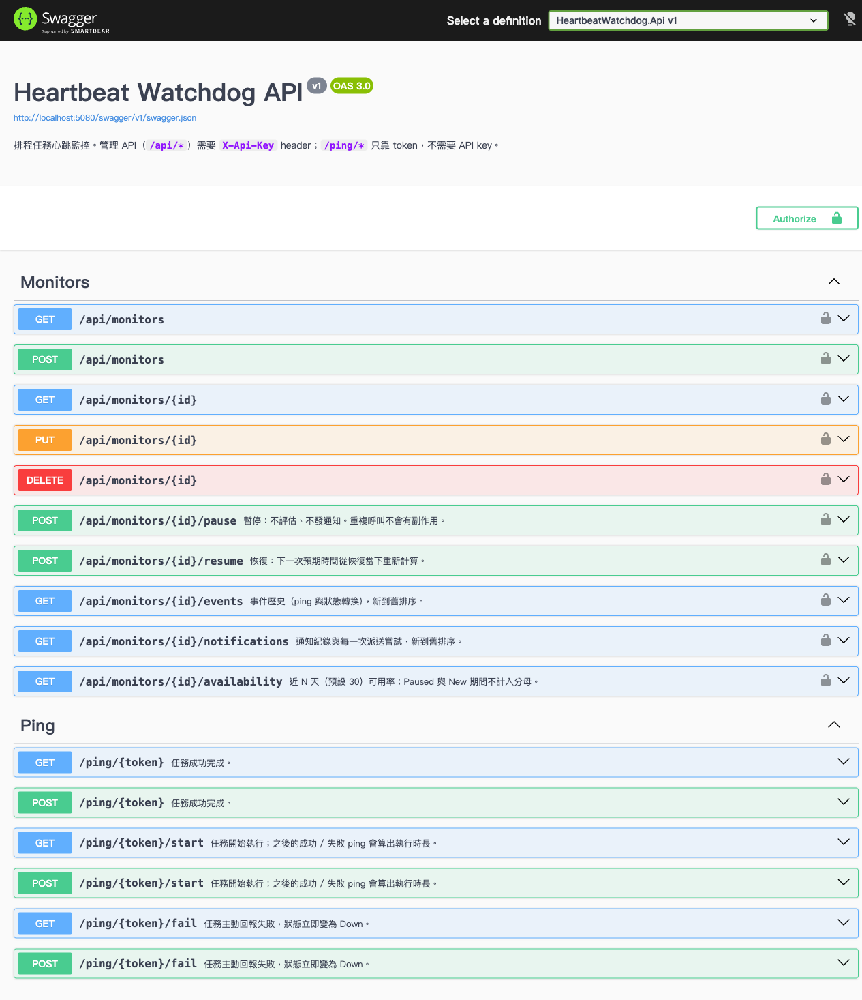
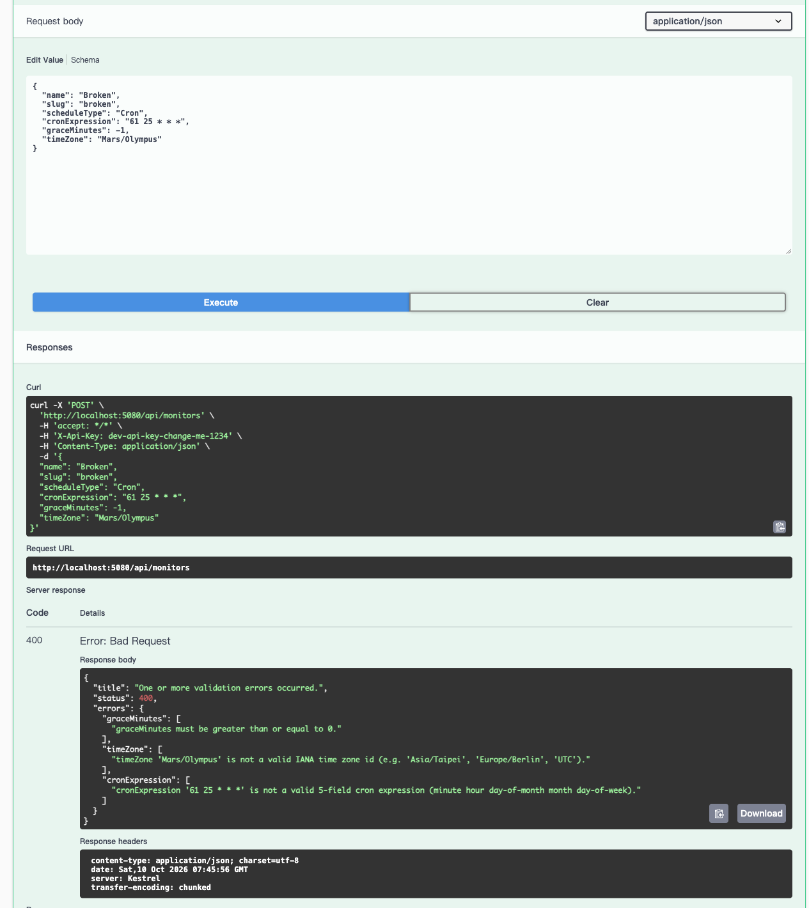
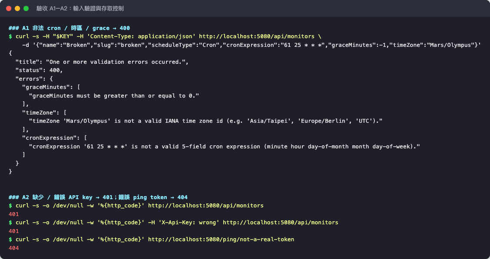
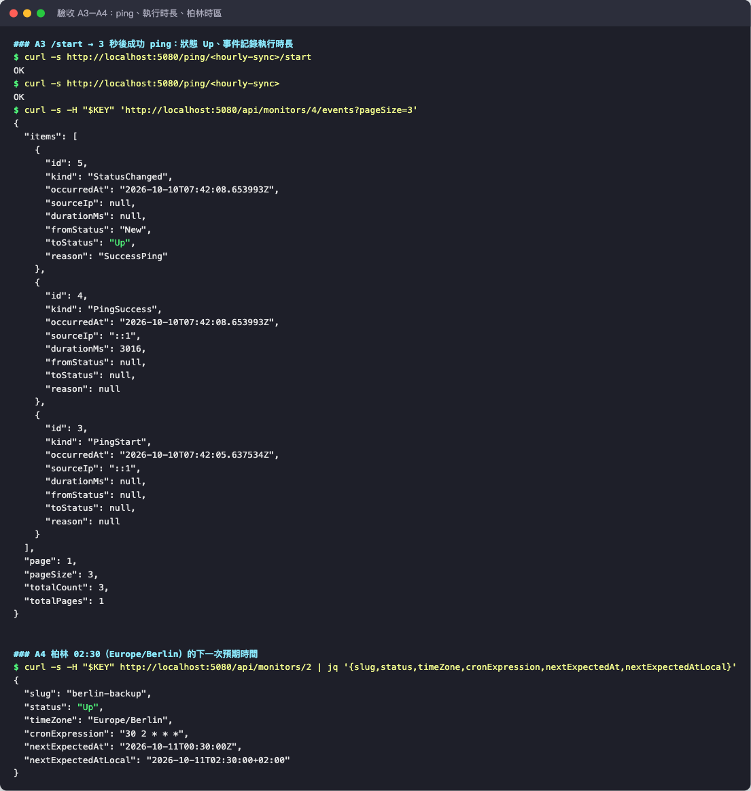
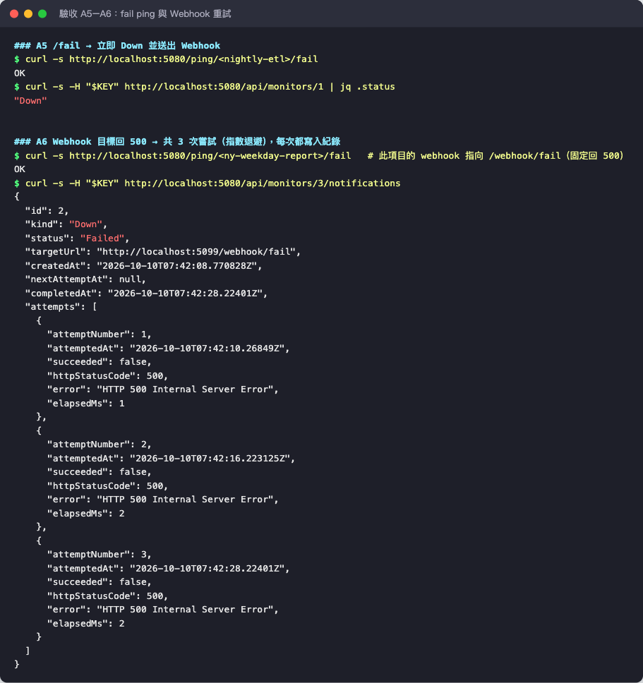
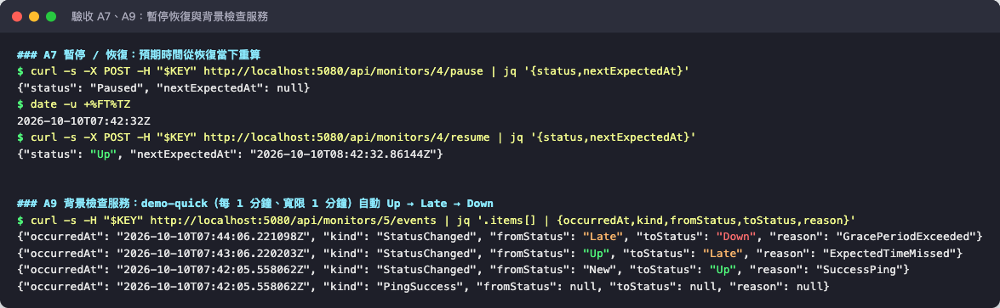
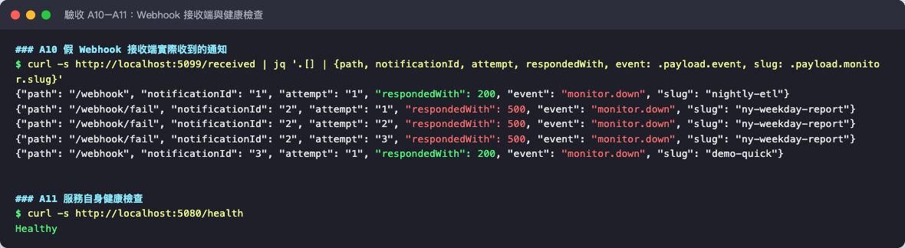
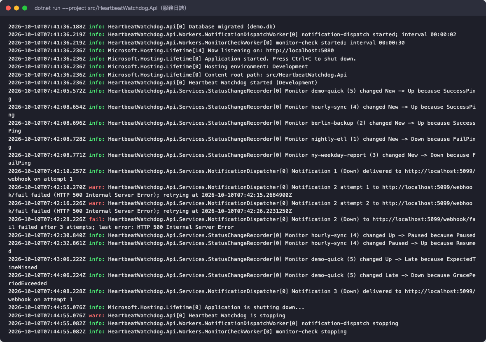
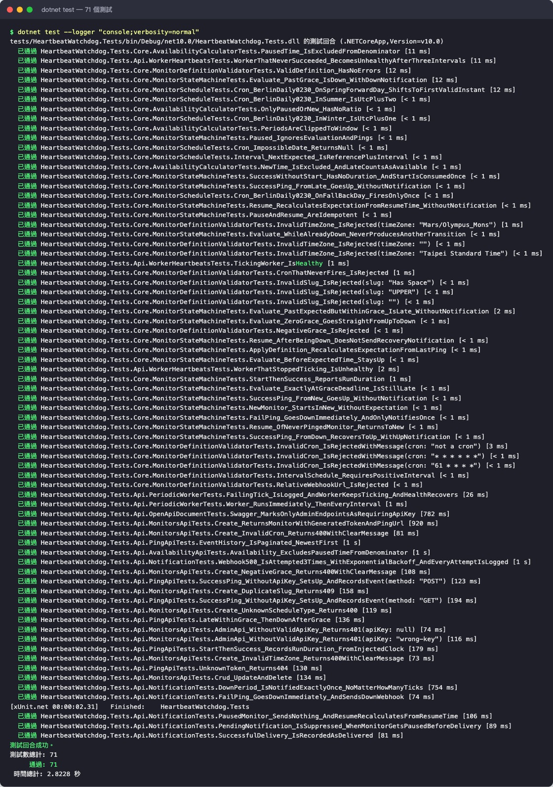
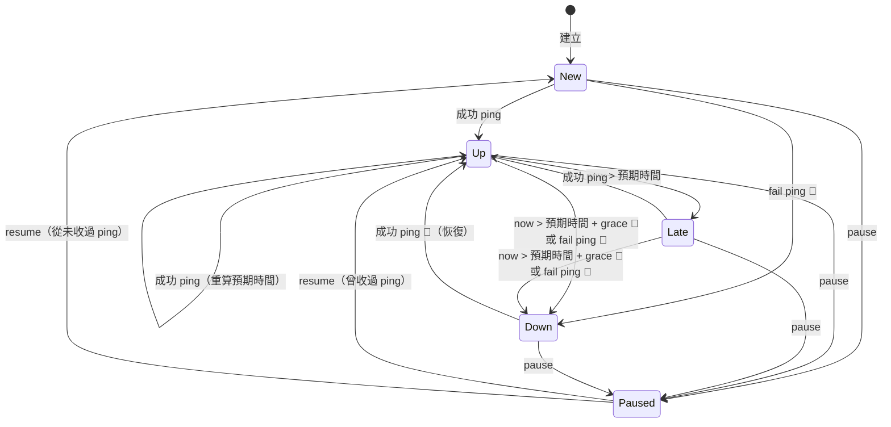

# Heartbeat Watchdog

排程任務心跳監控服務。夜間 ETL、備份這類排程任務跑完就 ping 一下；該來的 ping 沒來，或任務主動回報失敗，就對 Webhook 發通知。

- ASP.NET Core Web API（.NET 10）＋ EF Core＋SQLite
- cron 解析使用 [Cronos](https://github.com/HangfireIO/Cronos)，依監控項目的 IANA 時區解讀
- 所有時間邏輯透過 `TimeProvider` 注入；測試用 `FakeTimeProvider` 快轉，不等待真實時間
- Swagger UI：<http://localhost:5080/swagger>
- 測試：**71 個自動化測試全數通過**，手寫程式碼行覆蓋率 91.6%，11 項端對端驗收情境皆符合預期，詳見 **[測試報告](docs/TEST_REPORT.md)**

---

## 快速開始

需求：[.NET SDK 10](https://dotnet.microsoft.com/download)（`dotnet --version` ≥ 10.0）。

```bash
# 終端機 1：示範用的假 Webhook 接收端（http://localhost:5099）
dotnet run --project samples/FakeWebhookReceiver

# 終端機 2：監控服務（http://localhost:5080）
dotnet run --project src/HeartbeatWatchdog.Api

# 終端機 3：建立 5 個範例監控項目（台北、柏林、紐約、UTC、示範用每分鐘）
./scripts/seed.sh
```

- 第一次啟動會自動套用 migration，在 `src/HeartbeatWatchdog.Api/watchdog.db` 建立 SQLite 資料庫。
- Development 環境的 API key 是 `dev-api-key-change-me-1234`，預設 Webhook 指向假接收端（見 `appsettings.Development.json`）。
- Windows 或不想用 bash：`scripts/watchdog.http` 有全部的範例請求，可在 VS Code REST Client / Rider / Visual Studio 執行。

### 跑一次示範

```bash
KEY="X-Api-Key: dev-api-key-change-me-1234"
curl -s -H "$KEY" http://localhost:5080/api/monitors          # 拿到各項目的 pingUrl

curl http://localhost:5080/ping/<demo-quick 的 token>          # demo-quick 變成 Up
# 約 1 分鐘後變 Late、再約 1 分鐘後變 Down → 假接收端印出一次 monitor.down

curl http://localhost:5080/ping/<ny-weekday-report 的 token>/fail
# ny-weekday-report 的 webhook 指向 /webhook/fail（固定回 500）
# → 可看到 3 次嘗試（約 0s / +5s / +15s；派送 worker 每 2 秒檢查一次，實際會晚 1~2 秒）後標記為 Failed：
curl -s -H "$KEY" http://localhost:5080/api/monitors/3/notifications
```

### 在排程任務中使用

```bash
# crontab 範例：開始、成功、失敗都回報，且 ping 失敗不影響任務本身
30 2 * * * curl -fsS -m 10 --retry 3 https://watchdog.example.com/ping/<token>/start > /dev/null; \
           /opt/backup/run.sh \
           && curl -fsS -m 10 --retry 3 https://watchdog.example.com/ping/<token> > /dev/null \
           || curl -fsS -m 10 --retry 3 https://watchdog.example.com/ping/<token>/fail > /dev/null
```

### 執行測試

```bash
dotnet test
```

目前共 71 個測試（單元測試 43、整合測試 28），全部以 `FakeTimeProvider` 控制時間，不需要等待真實時間，約 3 秒跑完。測試範圍、覆蓋率與端對端驗收結果見 [docs/TEST_REPORT.md](docs/TEST_REPORT.md)。

---

## 截圖

以下截圖都是實際執行的畫面，完整的測試步驟與說明見[測試報告](docs/TEST_REPORT.md)。

### Swagger UI

管理 API 有鎖頭圖示（需要 `X-Api-Key`），`/ping/*` 只靠 token。



### 輸入驗證：非法 cron、時區、grace → 400

所有欄位的錯誤會一次回報，每則訊息都指出哪個值、為什麼不合法。



### 存取控制：401 / 404



### ping、執行時長與柏林時區

先 `/start`、3 秒後成功 ping，事件記錄 `durationMs: 3016`。柏林 `30 2 * * *` 的下一次預期時間是 `00:30Z`，也就是當地 `02:30+02:00`。



### fail ping 與 Webhook 重試

Webhook 目標回 500：共 3 次嘗試，以指數退避重送，每次嘗試都寫入紀錄，最終標記為 `Failed`。



### 暫停/恢復與背景檢查服務

恢復時預期時間從恢復當下重新計算。背景 worker 每 30 秒評估一次，讓沒有回報的項目自動走過 Up → Late → Down。



### Webhook 接收端與健康檢查

demo-quick 在 Down 之後雖然又跑了多個 tick，接收端仍只收到 1 次通知。



### 服務日誌

單行、UTC 時間戳。狀態轉換寫 `info`，Webhook 重試寫 `warn`，最終失敗寫 `fail`。



### 測試結果



---

## 設定

所有設定都可以用環境變數覆寫（`:` 換成 `__`），例如 `Watchdog__ApiKey`。

| 設定 | 預設值 | 說明 |
|---|---|---|
| `ConnectionStrings:Watchdog` | `Data Source=watchdog.db` | SQLite 連線字串 |
| `Watchdog:ApiKey` | （必填，≥ 16 字元） | 管理 API 金鑰。**未設定時服務拒絕啟動**（fail fast） |
| `Watchdog:DefaultWebhookUrl` | 空 | 監控項目沒有自己的 `webhookUrl` 時使用；都沒有則通知記為 `Skipped` 並寫警告日誌 |
| `Watchdog:CheckInterval` | `00:00:30` | 背景檢查 tick 間隔 |
| `Watchdog:DispatchInterval` | `00:00:02` | 通知派送 tick 間隔（決定重試退避的精細度） |
| `Watchdog:WebhookMaxAttempts` | `3` | 每則通知最多嘗試次數 |
| `Watchdog:WebhookRetryBaseDelay` | `00:00:05` | 指數退避基準：第 n 次失敗後等待 base × 2ⁿ⁻¹ |
| `Watchdog:WebhookTimeout` | `00:00:10` | 單次 Webhook 請求逾時 |

正式環境範例：

```bash
export ASPNETCORE_ENVIRONMENT=Production
export ASPNETCORE_URLS=http://0.0.0.0:8080
export Watchdog__ApiKey='<長且隨機的字串>'
export Watchdog__DefaultWebhookUrl='https://hooks.example.com/watchdog'
export ConnectionStrings__Watchdog='Data Source=/var/lib/watchdog/watchdog.db'
dotnet HeartbeatWatchdog.Api.dll
```

---

## API 一覽

管理 API（`/api/*`）需要 `X-Api-Key` header，缺少或錯誤回 **401**。`/ping/*` 只靠 token，不需要 API key。完整 schema 見 Swagger。

| Method | Path | 說明 |
|---|---|---|
| `GET` | `/api/monitors` | 列出所有監控項目 |
| `GET` | `/api/monitors/{id}` | 取得單一項目 |
| `POST` | `/api/monitors` | 建立（201）；驗證失敗 400；slug 重複 409 |
| `PUT` | `/api/monitors/{id}` | 更新（ping token 不變） |
| `DELETE` | `/api/monitors/{id}` | 刪除（連同事件、通知紀錄） |
| `POST` | `/api/monitors/{id}/pause` | 暫停（可重複呼叫） |
| `POST` | `/api/monitors/{id}/resume` | 恢復，預期時間從恢復當下重算 |
| `GET` | `/api/monitors/{id}/events?page=1&pageSize=50` | 事件歷史，新到舊（pageSize ≤ 200） |
| `GET` | `/api/monitors/{id}/notifications?page=1&pageSize=50` | 通知與每一次派送嘗試 |
| `GET` | `/api/monitors/{id}/availability?days=30` | 近 N 天可用率（1–365，預設 30） |
| `GET` / `POST` | `/ping/{token}` | 成功 |
| `GET` / `POST` | `/ping/{token}/start` | 開始執行 |
| `GET` / `POST` | `/ping/{token}/fail` | 主動回報失敗 |
| `GET` | `/health` | 服務自身健康狀態（背景 worker 卡住時回 503） |

錯誤 token 呼叫 ping 回 **404**。

### 建立監控項目

```json
POST /api/monitors
{
  "name": "Offsite backup (Berlin)",
  "slug": "berlin-backup",
  "scheduleType": "Cron",            // "Interval" 或 "Cron"
  "cronExpression": "30 2 * * *",    // Cron 時必填，標準 5 欄位
  "intervalMinutes": null,           // Interval 時必填，1 ~ 525600
  "graceMinutes": 45,                // 必填，>= 0
  "timeZone": "Europe/Berlin",       // IANA ID，省略時為 "UTC"
  "webhookUrl": null                 // 選填，覆寫預設 Webhook
}
```

驗證規則（違反時回 400，`errors` 以欄位為 key，所有錯誤一次回報）：

| 欄位 | 規則 |
|---|---|
| `name` | 必填，≤ 200 字元 |
| `slug` | 唯一；小寫英數字與單一連字號，如 `nightly-etl`，≤ 100 字元 |
| `cronExpression` | 合法的 5 欄位 cron；**永遠不會觸發的**（如 `0 0 30 2 *`）也拒絕 |
| `timeZone` | 必須是 IANA ID；Windows ID（如 `Taipei Standard Time`）拒絕 |
| `graceMinutes` | ≥ 0 |
| `webhookUrl` | 絕對 http/https URL |

```json
// 400 回應範例
{
  "title": "One or more validation errors occurred.",
  "status": 400,
  "errors": {
    "cronExpression": ["cronExpression '61 25 * * *' is not a valid 5-field cron expression (minute hour day-of-month month day-of-week)."],
    "timeZone": ["timeZone 'Mars/Olympus' is not a valid IANA time zone id (e.g. 'Asia/Taipei', 'Europe/Berlin', 'UTC')."],
    "graceMinutes": ["graceMinutes must be greater than or equal to 0."]
  }
}
```

回應中所有時間皆為 UTC（`Z` 結尾）；另外提供 `nextExpectedAtLocal`，是以該項目時區表示的下一次預期時間，方便人工核對（例如柏林項目會顯示 `2026-10-10T02:30:00+02:00`）。

---

## 狀態機



🔔 = 發送 Webhook。只有「進入 Down」與「Down → Up」會通知。

### 轉換規則

設 `E` = 下一次預期時間（`nextExpectedAt`），`G` = 寬限時間。

| 目前狀態 | 事件 | 結果 | 通知 |
|---|---|---|---|
| 任何（Paused 除外） | 成功 ping | `Up`；`E` = 排程中 now 之後的下一次 | 若原本是 Down → **up** |
| 任何（Paused 除外） | fail ping | `Down` | 若原本不是 Down → **down** |
| 任何 | start ping | 狀態不變，記錄開始時間 | — |
| `Up` | tick，`E < now ≤ E+G` | `Late` | — |
| `Up` / `Late` | tick，`now > E+G` | `Down` | **down** |
| `New` / `Down` / `Paused` | tick | 不變 | — |
| 非 Paused | pause | `Paused`，清除 `E` | — |
| `Paused` | resume | 曾收過 ping → `Up`，`E` = now 之後的下一次；否則 → `New` | — |
| `Paused` | 任何 ping | 只記錄事件，狀態不變 | — |

邊界：「超過」一律是嚴格大於；`now == E+G` 仍是 Late。`G = 0` 時錯過預期時間直接從 Up 變 Down。

**執行時長**：收到 start 後，下一個成功或 fail ping 會計算 `now − start`，寫在該 ping 事件的 `durationMs`。start 只會被用一次；沒有 start 的成功 ping 不帶時長。

所有規則都在 `tests/HeartbeatWatchdog.Tests/Core/MonitorStateMachineTests.cs` 有對應測試。

---

## Webhook

狀態進入 `Down`、或從 `Down` 恢復為 `Up` 時，對 Webhook URL 發送 `POST`，`Content-Type: application/json`。

### Payload

```json
{
  "event": "monitor.down",                 // "monitor.down" | "monitor.up"
  "monitor": {
    "id": 2,
    "name": "Offsite backup (Berlin)",
    "slug": "berlin-backup",
    "timeZone": "Europe/Berlin"
  },
  "status": "Down",                        // 轉換後狀態
  "previousStatus": "Late",                // 轉換前狀態
  "reason": "GracePeriodExceeded",         // GracePeriodExceeded | FailPing | SuccessPing
  "occurredAt": "2026-10-10T01:15:30Z",    // 轉換發生時間（UTC）
  "lastPingAt": "2026-10-09T00:31:02Z",    // 最後一次 ping（UTC，可能為 null）
  "nextExpectedAt": "2026-10-10T00:30:00Z" // 當時的預期時間（UTC，可能為 null）
}
```

Header：

| Header | 說明 |
|---|---|
| `X-Watchdog-Notification-Id` | 通知 ID；重試時不變，接收端可用來去重 |
| `X-Watchdog-Attempt` | 第幾次嘗試（1 起算） |

### 重試

- 2xx 視為成功；其他狀態碼、連線失敗、逾時都算失敗。
- 最多 **3 次嘗試**（第一次＋兩次重試），間隔為指數退避：失敗後等 5s、10s（`base × 2ⁿ⁻¹`）。
- **每一次嘗試**都寫入 `NotificationAttempts`（時間、HTTP 狀態碼、錯誤訊息、耗時），通知本身最終狀態為 `Delivered` 或 `Failed`。
- 派送前若監控項目已被暫停或刪除，通知標記為 `Suppressed`，不發送。

> 題目「失敗要重試 3 次」與驗收標準「可看到 3 筆嘗試」一起看，解讀為**總共 3 次嘗試**。若要「首次＋重試 3 次」，把 `Watchdog:WebhookMaxAttempts` 設為 4 即可。

---

## 可用率

`GET /api/monitors/{id}/availability` 回傳：

```json
{
  "monitorId": 2, "days": 30,
  "from": "2026-09-09T08:00:00Z", "to": "2026-10-09T08:00:00Z",
  "availability": 0.8,            // 無受監控時間時為 null
  "upSeconds": 28800, "monitoredSeconds": 36000, "pausedSeconds": 36000
}
```

```
availability = (Up + Late 時間) ÷ (Up + Late + Down 時間)
```

- **Paused 不計入分母**（題目要求）。
- **New 不計入分母**：還沒收到第一個 ping 之前，服務並未真正在監控該任務。
- **Late 算可用**：任務仍在寬限時間內、尚未被判定失敗；寬限時間的意義就是「這段延遲是可以接受的」。

計算基礎是 `StatusPeriods` 表：每次狀態轉換都會關閉目前區間、開啟新區間，查詢時把區間裁切到視窗內再加總。

---

## 設計決策

### 時間一律 UTC，時區只用在 cron 解讀
資料庫裡的 `DateTime` 都經過 value converter：寫入非 UTC 值會直接丟例外，讀出時標記 `Kind = Utc`。時區只在一個地方使用：`MonitorSchedule.NextAfter()` 把 cron 依項目時區算出下一次觸發，再轉回 UTC。所以柏林主機設定的 `30 2 * * *` 在夏季是 00:30 UTC、冬季是 01:30 UTC，不需要任何人工調整。

**夏令時間**：Cronos 的處理方式，春季跳過的時刻（柏林 3 月最後一個週日沒有 02:30）會改在跳躍後的第一個時刻（03:00 CEST）觸發，不會整天跳過；秋季重複的時刻只觸發一次。有測試覆蓋。

### 狀態機是純邏輯
`HeartbeatMonitor`（`src/HeartbeatWatchdog.Core`）不讀時鐘、不碰資料庫，每個方法都接收呼叫端傳入的 `nowUtc` 並回傳 `StatusTransition?`。所有 Late/Down 邊界、暫停恢復、時長計算都能用單元測試精確驗證。

### 「每次轉換只通知一次」怎麼保證
1. **狀態機層**：通知綁在「轉換」上，而不是狀態本身。已經是 Down 再評估 100 次也不會產生轉換，自然沒有通知。不需要「已通知」這類額外旗標。
2. **持久層（outbox）**：狀態變更、事件、狀態區間、待送通知在**同一次 `SaveChanges`**（同一個 transaction）寫入。服務在任何時間點崩潰都不會出現「狀態已是 Down 但通知遺失」或「通知送了但狀態沒變」，重啟後派送服務會接續送出待送通知。
3. Webhook 派送與狀態評估分開：Webhook 很慢或掛掉，不會拖慢 ping 處理或下一個檢查 tick。

### 並行控制：行程內鎖
ping、檢查 tick、暫停/恢復、更新都會改監控項目狀態。若 tick 讀到舊狀態後才存檔，可能覆寫剛收到的 ping。題目假設單一執行個體，所以用一個行程內的 `SemaphoreSlim`（`MonitorMutationLock`）序列化這些寫入；二十幾個任務的負載下，這比樂觀並行控制加重試簡單、也更好理解。若未來要多節點部署，需要改用資料庫層的鎖或並行權杖。

### 恢復暫停不回溯
恢復時 `nextExpectedAt` 從**恢復當下**重新計算，暫停期間錯過的排程不會在恢復後立刻變成 Late/Down。恢復本身不送通知（即使暫停前是 Down）：暫停代表有人在處理，恢復時給任務一個完整週期證明自己。

### New 不會變 Late/Down
新建立的項目在收到第一個 ping 之前維持 New，不會告警，避免「剛建立還沒部署到主機上」就收到 Down 通知。fail ping 例外：任務明確回報失敗，一定要通知。

### Cron 的預期時間以「最後一次 ping」起算
收到 ping 後，下一次預期時間是排程中「ping 時刻之後」的下一個觸發點。02:30 開始的備份在 02:55 回報成功，預期時間就是隔天 02:30；寬限時間要涵蓋任務本身的執行時長。

### 其他
- **SQLite**：單一租戶、二十幾個任務，不需要另外架資料庫；`dotnet run` 即可啟動。
- **Ping token**：144 bits 隨機值、URL-safe base64；token 本身就是 ping 的認證。
- **API key 比較**：`CryptographicOperations.FixedTimeEquals`，避免時間側通道。
- **來源 IP**：記錄 `HttpContext.Connection.RemoteIpAddress`。若部署在反向代理後面，需要另外設定 `ForwardedHeaders` 中介軟體（本專案未啟用，以免信任偽造的 header）。

---

## 自我監控與日誌

> 監控別人的服務自己默默掛掉，是這類服務最諷刺的情況。

- **啟動即驗證**：缺 API key、設定不合法時直接拒絕啟動並說明原因，不會帶著錯誤設定默默執行。
- **tick 失敗不會讓 worker 停止**：單一 tick 的例外記錄為 `Error` 並附 stack trace，下個 tick 繼續。
- **worker 崩潰會讓行程結束**：若 worker 迴圈本身意外終止，記錄 `Critical` 後依 `BackgroundServiceExceptionBehavior.StopHost` 結束行程，交給 systemd / Docker 重啟。「行程活著但沒在檢查」比「行程掛掉被重啟」危險得多。
- **最後一道防線**：`AppDomain.UnhandledException`、`TaskScheduler.UnobservedTaskException`、host 異常終止都會寫 `Critical` / `Error` 日誌。
- **`/health`**：每個背景 worker 成功完成 tick 時打卡；超過 3 個間隔沒打卡就回 **503**。建議用另一套外部監控（例如 uptime 服務、或另一台主機的 cron）定期檢查 `/health`。
- **日誌格式**：單行、UTC 時間戳（`2026-10-09T08:09:38.323Z warn: ...`）、結構化欄位（slug、狀態、原因、通知 ID）。每次狀態轉換寫 Information，Webhook 重試寫 Warning，最終失敗寫 Error。

---

## 專案結構

```
src/
  HeartbeatWatchdog.Core/        純領域邏輯（無 I/O）
    HeartbeatMonitor.cs          監控項目＋狀態機
    MonitorSchedule.cs           下一次預期時間（Interval / Cron + 時區）
    MonitorDefinitionValidator   輸入驗證
    AvailabilityCalculator.cs    可用率
    Notification.cs              通知 outbox 與重試退避
  HeartbeatWatchdog.Api/
    Controllers/                 MonitorsController（管理 API）、PingController
    Services/                    MonitorCommands、MonitorEvaluator、NotificationDispatcher、WebhookSender…
    Workers/                     MonitorCheckWorker（30s）、NotificationDispatchWorker（2s）、健康檢查
    Data/                        DbContext 與 migrations
samples/
  FakeWebhookReceiver/           假 Webhook 接收端（/webhook 回 200、/webhook/fail 回 500）
scripts/
  seed.sh                        建立 5 個範例監控項目
  watchdog.http                  所有 API 的範例請求
docs/
  TEST_REPORT.md                 測試報告（結果、覆蓋率、端對端驗收）
  images/                        截圖
tests/
  HeartbeatWatchdog.Tests/
    Core/                        狀態機、排程、驗證、可用率的單元測試
    Api/                         WebApplicationFactory 整合測試（FakeTimeProvider + 假 Webhook handler）
```

### 新增 migration

```bash
dotnet tool install --global dotnet-ef   # 若尚未安裝
cd src/HeartbeatWatchdog.Api
dotnet ef migrations add <Name> -o Data/Migrations
```

---

## 驗收標準對照

| 驗收標準 | 測試 |
|---|---|
| 非法 cron / 時區 / grace < 0 回 400 並帶明確訊息 | `MonitorsApiTests.Create_Invalid*`、`MonitorDefinitionValidatorTests` |
| 缺少或錯誤 API key 回 401 | `MonitorsApiTests.AdminApi_WithoutValidApiKey_Returns401` |
| 錯誤 token 回 404 | `PingApiTests.UnknownToken_Returns404` |
| 成功 ping → Up 並寫入事件 | `PingApiTests.SuccessPing_WithoutApiKey_SetsUp_AndRecordsEvent` |
| start → 成功，執行時長正確（注入時鐘） | `PingApiTests.StartThenSuccess_RecordsRunDuration_FromInjectedClock`、`MonitorStateMachineTests.StartThenSuccess_ReportsRunDuration` |
| grace 內為 Late、超過為 Down | `PingApiTests.LateWithinGrace_ThenDownAfterGrace`、`MonitorStateMachineTests.Evaluate_*` |
| fail ping 立即 Down 並通知 | `NotificationTests.FailPing_GoesDownImmediately_AndSendsDownWebhook` |
| 同一次 Down 不論幾個 tick 只通知一次 | `NotificationTests.DownPeriod_IsNotifiedExactlyOnce_NoMatterHowManyTicks`（480 個 tick） |
| Webhook 500 → 3 筆嘗試與最終結果 | `NotificationTests.Webhook500_IsAttempted3Times_WithExponentialBackoff_AndEveryAttemptIsLogged` |
| 暫停不通知；恢復後從恢復時間重算 | `NotificationTests.PausedMonitor_SendsNothing_AndResumeRecalculatesFromResumeTime`、`MonitorStateMachineTests.Resume_*` |
| 可用率排除 Paused | `AvailabilityApiTests.Availability_ExcludesPausedTimeFromDenominator`、`AvailabilityCalculatorTests` |
| 時間邏輯皆注入、測試不 sleep | 全部測試使用 `FakeTimeProvider`；專案中沒有 `Thread.Sleep` / `Task.Delay` |
| 3 種以上排程與時區的範例 | `scripts/seed.sh`（Asia/Taipei cron、Europe/Berlin cron、America/New_York cron、UTC interval、Asia/Taipei interval） |
| 柏林 02:30 夏令時間 | `MonitorScheduleTests.Cron_Berlin*` |
| BackgroundService 每 30 秒評估、tick 失敗不中斷 | `PeriodicWorkerTests` |
| 服務自身監控（worker 卡住時 /health 回 503） | `WorkerHeartbeatsTests` |
| Swagger 正確標示哪些端點需要 API key | `OpenApiDocumentTests` |

各項的端對端驗證結果與截圖見[測試報告 §5–6](docs/TEST_REPORT.md#5-驗收標準對照)。

## 範圍外

依題目假設，以下不在本次範圍：使用者帳號／多租戶、Email／LINE 通知、多節點部署、事件歷史清理。
