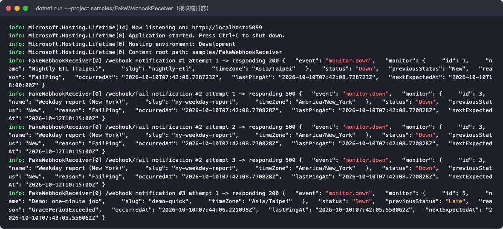

# 測試報告：Heartbeat Watchdog

| 項目 | 內容 |
|---|---|
| 測試日期 | 2026-10-10 |
| 受測版本 | `main`，本報告隨附的 commit |
| 結論 | **通過**。71 個自動化測試全數通過；11 項端對端驗收情境全部符合預期；題目所列驗收標準皆有對應的自動化測試 |

---

## 1. 摘要

| 指標 | 結果 |
|---|---|
| 自動化測試 | **71 / 71 通過**（0 失敗、0 略過），約 3 秒 |
| 單元測試（Core） | 43 個 |
| 整合測試（API） | 28 個 |
| 手寫程式碼行覆蓋率 | **91.6%**（918 / 1002） |
| 手寫程式碼分支覆蓋率 | **81.2%**（238 / 293） |
| 端對端驗收情境 | **11 / 11 符合預期** |
| 建置 | 0 警告、0 錯誤（`TreatWarningsAsErrors` 已開啟） |
| 測試期間發現的缺陷 | 2 項，**皆已修正並補上回歸測試**（見第 7 節） |

---

## 2. 測試環境

| 項目 | 版本 |
|---|---|
| 作業系統 | macOS 27.0（arm64，Apple M4 Pro） |
| .NET SDK | 10.0.401 |
| 執行環境 | Microsoft.NETCore.App 10.0.12、Microsoft.AspNetCore.App 10.0.12 |
| 測試框架 | xUnit 2.9.3、Microsoft.AspNetCore.Mvc.Testing 10.0.12、Microsoft.Extensions.TimeProvider.Testing 10.10.0 |
| 覆蓋率工具 | coverlet.collector 6.0.4（`--collect:"XPlat Code Coverage"`） |
| 資料庫 | SQLite（每個整合測試使用獨立的暫存資料庫檔） |
| 端對端測試瀏覽器 | Chromium（Playwright），用於 Swagger UI 操作與截圖 |

---

## 3. 測試範圍與方法

| 層級 | 範圍 | 方法 |
|---|---|---|
| **單元測試** | 狀態機、排程計算（含夏令時間）、輸入驗證、可用率計算 | 直接呼叫 `Core` 中的純邏輯；時間由測試傳入 |
| **整合測試** | HTTP API、驗證、資料庫、通知派送與重試、背景 worker 迴圈、OpenAPI 文件 | `WebApplicationFactory` 啟動完整應用程式。時鐘換成 `FakeTimeProvider`，Webhook 改由測試用的 `HttpMessageHandler` 攔截，每個測試使用獨立的 SQLite 檔 |
| **端對端測試（手動腳本）** | 實際以 `dotnet run` 啟動服務與假 Webhook 接收端，走過所有驗收情境 | 使用 curl 與 Playwright，依 README 步驟操作，並保存指令與回應的逐字紀錄 |

**時間控制原則**：所有自動化測試都以 `FakeTimeProvider` 快轉時間，專案中沒有任何 `Thread.Sleep` 或 `Task.Delay`。例如「Down 期間跑 480 個 tick」等於模擬 4 小時，實際執行不到 1 秒。

---

## 4. 自動化測試結果

```
dotnet test --logger "console;verbosity=normal"
測試回合成功。
測試數總計: 71
     通過: 71
```


### 4.1 各測試類別

| 測試類別 | 層級 | 數量 | 結果 | 涵蓋內容 |
|---|---|---:|---|---|
| `MonitorStateMachineTests` | 單元 | 19 | ✅ | 狀態轉換、Late/Down 邊界、只通知一次、暫停/恢復、執行時長 |
| `MonitorDefinitionValidatorTests` | 單元 | 14 | ✅ | 非法 cron、時區、grace、slug、interval、webhook URL |
| `MonitorScheduleTests` | 單元 | 6 | ✅ | interval、柏林 cron 夏季/冬季、DST 春季跳躍日與秋季退回日、永不觸發的 cron |
| `AvailabilityCalculatorTests` | 單元 | 4 | ✅ | Paused/New 排除、Late 算可用、區間裁切到視窗 |
| `MonitorsApiTests` | 整合 | 9 | ✅ | CRUD、400 錯誤訊息、409 slug 重複、401 API key |
| `PingApiTests` | 整合 | 6 | ✅ | GET/POST ping、404、事件紀錄與來源 IP、執行時長、Late→Down、分頁 |
| `NotificationTests` | 整合 | 6 | ✅ | fail→Down 並通知、Down 只通知一次、500 重試 3 次、暫停不通知、恢復後重算 |
| `AvailabilityApiTests` | 整合 | 1 | ✅ | 可用率 API 排除 Paused 區間 |
| `WorkerHeartbeatsTests` | 整合 | 3 | ✅ | `/health` 自我監控：worker 停止 tick 時判定為不健康 |
| `PeriodicWorkerTests` | 整合 | 2 | ✅ | 背景迴圈每 30 秒 tick；單一 tick 失敗後仍繼續執行 |
| `OpenApiDocumentTests` | 整合 | 1 | ✅ | Swagger 只把管理 API 標為需要 X-Api-Key |
| **合計** | | **71** | ✅ | |

---

## 5. 驗收標準對照

| # | 驗收標準 | 自動化測試 | 端對端證據 | 結果 |
|---|---|---|---|---|
| 1 | `dotnet run` 後依 README 可跑起來 | — | 交付前已從乾淨的 git clone 照 README 驗證；本次以全新資料庫重跑（§6） | ✅ |
| 2 | 非法 cron、時區、grace<0 回 400 並帶明確訊息 | `Create_InvalidCron_…`、`Create_InvalidTimeZone_…`、`Create_NegativeGrace_…`，以及 Validator 14 個測試 | A1、Swagger 截圖 | ✅ |
| 3 | API key 缺少或錯誤回 401；ping token 錯誤回 404 | `AdminApi_WithoutValidApiKey_Returns401` ×2、`UnknownToken_Returns404` | A2 | ✅ |
| 4 | 成功 ping 後狀態為 Up，並寫入事件 | `SuccessPing_WithoutApiKey_SetsUp_AndRecordsEvent` ×2 | A3 | ✅ |
| 5 | 先 start 再成功 ping，執行時長正確（可注入時鐘） | `StartThenSuccess_RecordsRunDuration_FromInjectedClock`（精確 754,000 ms） | A3（3016 ms） | ✅ |
| 6 | grace 內為 Late、超過為 Down | `LateWithinGrace_ThenDownAfterGrace`、`Evaluate_*` ×6 | A9（真實 worker） | ✅ |
| 7 | fail ping 立即 Down 並觸發通知 | `FailPing_GoesDownImmediately_AndSendsDownWebhook` | A5、A10 | ✅ |
| 8 | 同一次 Down 期間只收到一次通知 | `DownPeriod_IsNotifiedExactlyOnce_NoMatterHowManyTicks`（480 個 tick） | A9、A10 | ✅ |
| 9 | Webhook 回 500 時重試，可看到 3 筆嘗試與最終結果 | `Webhook500_IsAttempted3Times_WithExponentialBackoff_AndEveryAttemptIsLogged` | A6、A10、服務日誌 | ✅ |
| 10 | 暫停時不發通知；恢復後依恢復時間重算預期時間 | `PausedMonitor_SendsNothing_AndResumeRecalculatesFromResumeTime`、`PendingNotification_IsSuppressed_…`、`Resume_*` ×3 | A7 | ✅ |
| 11 | 可用率在有 Paused 區間時排除暫停時段 | `Availability_ExcludesPausedTimeFromDenominator`、`PausedTime_IsExcludedFromDenominator` | A8 | ✅ |
| 12 | 時間邏輯透過 TimeProvider 注入，不用 Thread.Sleep | 全部測試使用 `FakeTimeProvider` | 原始碼中搜尋不到 `Thread.Sleep` 與 `Task.Delay` | ✅ |
| 13 | 至少 3 種不同排程與時區的範例 | — | `seed.sh` 共 5 個：台北、柏林、紐約、UTC，含 cron 與 interval | ✅ |
| 14 | 至少 15 個單元測試，`dotnet test` 全數通過 | 71 個 | §4 | ✅ |
| 15 | BackgroundService 每 30 秒評估一次 | `Worker_RunsImmediately_ThenEveryInterval` | A9（worker 於 07:41:36 啟動，轉換發生在 07:43:06、07:44:06，皆落在 30 秒的 tick 上） | ✅ |
| 16 | 服務崩潰時留下像樣的日誌 | `FailingTick_IsLogged_AndWorkerKeepsTicking_AndHealthRecovers`、`WorkerThatStoppedTicking_IsUnhealthy` | 服務日誌截圖 | ✅ |

---

## 6. 端對端驗收測試

**步驟**：使用全新的 SQLite 資料庫，依 README「快速開始」啟動假 Webhook 接收端（:5099）與 API（:5080），執行 `./scripts/seed.sh` 建立 5 個監控項目，再依序執行以下情境。截圖內容是實際指令與實際回應。

> 備註：截圖中標示為 `| jq …` 的過濾步驟，實際執行時是用等效的 Python 處理（本機未安裝 jq），輸出欄位相同。`<hourly-sync>` 等寫法代表該項目的 ping token。

### 6.1 Swagger UI

服務啟動後，`http://localhost:5080/swagger` 列出所有端點。管理 API 有鎖頭圖示（需要 X-Api-Key），`/ping/*` 沒有。


在 Swagger UI 中按 Authorize 輸入金鑰，用 Try it out 送出含 3 個錯誤欄位的請求：回應為 **400**，三個欄位的錯誤訊息一次全部回報。


### 6.2 A1–A2：輸入驗證與存取控制

| 情境 | 預期 | 實際 |
|---|---|---|
| 非法 cron + 非法時區 + grace = −1 | 400，各欄位有明確訊息 | ✅ 400，3 個欄位各一則訊息 |
| 未帶 API key | 401 | ✅ 401 |
| API key 錯誤 | 401 | ✅ 401 |
| ping token 錯誤 | 404 | ✅ 404 |


### 6.3 A3–A4：ping、執行時長、時區

| 情境 | 預期 | 實際 |
|---|---|---|
| start → 等 3 秒 → 成功 | 狀態 Up，事件記錄執行時長約 3000 ms | ✅ `durationMs: 3016`、New→Up、來源 IP `::1` |
| 柏林 `30 2 * * *` | 下一次為柏林當地 02:30 | ✅ `00:30Z` = `02:30+02:00`（10 月仍為夏令時間） |


### 6.4 A5–A6：fail ping 與 Webhook 重試

| 情境 | 預期 | 實際 |
|---|---|---|
| nightly-etl 收到 `/fail` | 立即變為 Down，Webhook 送達 | ✅ Down；通知 #1 第一次嘗試即回 200 |
| ny-weekday-report 收到 `/fail`，其 Webhook 固定回 500 | 共 3 次嘗試、指數退避、全部記錄、最終狀態為 Failed | ✅ 3 筆嘗試，時間點為 +0s / +6s / +18s，最終 `Failed` |

> 退避設定為 5s、10s；實際間隔多了約 1–2 秒，原因是派送 worker 每 2 秒檢查一次（`DispatchInterval`）。這符合設計（見 README「重試」）。


### 6.5 A7、A9：暫停/恢復與背景檢查服務

| 情境 | 預期 | 實際 |
|---|---|---|
| 暫停 hourly-sync | Paused，清除預期時間 | ✅ `Paused`、`nextExpectedAt: null` |
| 在 07:42:32 恢復 | 預期時間從恢復當下重算（+60 分鐘） | ✅ `08:42:32Z` |
| demo-quick（每 1 分鐘、寬限 1 分鐘）ping 後不再 ping | 真實背景 worker 自動走過 Up→Late→Down | ✅ 07:42:05 Up → 07:43:06 Late → 07:44:06 Down |


### 6.6 A10–A11：Webhook 接收端與健康檢查

| 情境 | 預期 | 實際 |
|---|---|---|
| 接收端收到的通知 | nightly-etl ×1、ny-weekday-report ×3（重試）、demo-quick ×1 | ✅ 完全相符；demo-quick 在 Down 之後雖有多個 tick，仍只收到 1 次 |
| `/health` | Healthy | ✅ |

> A8（可用率）的端對端執行結果為 `availability: 1`、`pausedSeconds: 2.02`：暫停的 2 秒未計入分母。由於示範時間很短，數值本身不具代表性；「Paused 不計入分母」的精確驗證（80% 的情境）在 `Availability_ExcludesPausedTimeFromDenominator` 中完成。


### 6.7 服務日誌

服務日誌使用單行格式、UTC 時間戳，每次狀態轉換都有紀錄。Webhook 重試時寫 `warn`，最終失敗時升級為 `fail`，關閉時也有對應訊息。


假 Webhook 接收端記錄每次請求的通知 ID、嘗試次數與 payload：



---

## 7. 測試期間發現並修正的缺陷

| # | 缺陷 | 如何發現 | 影響 | 修正 | 回歸測試 |
|---|---|---|---|---|---|
| 1 | 背景 worker 迴圈（`PeriodicWorker`）沒有自動化測試，覆蓋率 0% | 覆蓋率報告 | 「每 30 秒評估」與「tick 失敗後繼續執行」只靠手動驗證，未來改動可能悄悄壞掉 | 以 `FakeTimeProvider` 驅動真正的 `PeriodicTimer` 迴圈補上測試（`PeriodicWorker` 覆蓋率 0% → 85.7%） | `PeriodicWorkerTests` ×2（連續執行 5 次皆穩定） |
| 2 | Swagger 把 `/ping/*` 也標成需要 X-Api-Key | 截圖時目視發現 | 文件與實際行為不符，使用者會誤以為 ping 需要金鑰 | 改用 `ApiKeyOperationFilter`，只標示掛有 `[RequireApiKey]` 的端點；同時修正描述中的 `/api/*` 被 Markdown 解析成斜體的問題 | `OpenApiDocumentTests`（先確認失敗，修正後通過） |

兩項都沒有影響 API 的實際行為：`/ping/*` 一直都不需要 API key，背景 worker 在端對端測試中也一直正常運作。

---

## 8. 程式碼覆蓋率

排除自動產生的程式碼（EF migrations、Regex source generator）後：

| 範圍 | 行覆蓋率 | 分支覆蓋率 |
|---|---|---|
| **全部手寫程式碼** | **91.6%**（918 / 1002） | **81.2%**（238 / 293） |
| `HeartbeatWatchdog.Core` | 93.7%（311 / 332） | 86.9%（119 / 137） |
| `HeartbeatWatchdog.Api` | 90.6%（607 / 670） | 76.3%（119 / 156） |
| （含自動產生的程式碼） | 93.1% | 79.2% |

核心邏輯的覆蓋情況：`HeartbeatMonitor`（狀態機）100%、`MonitorEvaluator` 100%、`NotificationDispatcher` 100%、`StatusTransition` 100%、`AvailabilityCalculator` 93.5%。

### 未覆蓋的部分

| 檔案 | 行覆蓋率 | 說明 |
|---|---|---|
| `MonitorCheckWorker.cs`、`NotificationDispatchWorker.cs` | 0%（各 4 行） | 只有「讀取設定的間隔」與「呼叫 evaluator / dispatcher」兩行接線程式碼。迴圈本身由 `PeriodicWorkerTests` 覆蓋；接線部分由端對端測試 A6、A9 驗證（真實 worker 確實每 30 秒評估、每 2 秒派送） |
| `MonitorsController.cs` | 79.2% | 未覆蓋的是分頁參數超出範圍（400）、`days` 超出範圍（400），以及 pause / resume / events / notifications 對不存在的 id 回 404 等錯誤路徑 |
| `MonitorDefinitionValidator.cs` | 81.0% | 未覆蓋 name 空白或過長等邊界，以及非法 scheduleType 的分支 |
| `Program.cs` | 91.9% | 未覆蓋啟動失敗與未處理例外時的 Critical 日誌路徑（需要讓行程真的崩潰才能觸發） |

以上都不在題目的驗收標準範圍內，但如果要繼續加強測試，這些是優先順序最高的項目。

---

## 9. 已知限制

- **單一執行個體**：並行控制使用行程內的鎖，依題目假設不支援多節點部署。
- **來源 IP**：記錄的是 TCP 連線的來源位址。部署在反向代理後面時需要另外設定 `ForwardedHeaders`。
- **重試次數解讀**：「失敗要重試 3 次」解讀為「總共 3 次嘗試」，以符合驗收標準「可看到 3 筆嘗試」。可透過 `Watchdog:WebhookMaxAttempts` 調整。
- **端對端可用率**：示範時間很短，數值不具代表性；精確驗證以整合測試為準（§6.6）。

---

## 10. 如何重現

```bash
# 自動化測試
dotnet test

# 附逐項結果、TRX 與覆蓋率
dotnet test --logger "console;verbosity=normal" --logger "trx;LogFileName=results.trx" \
            --collect:"XPlat Code Coverage" --results-directory ./TestResults

# 端對端（三個終端機）
dotnet run --project samples/FakeWebhookReceiver
dotnet run --project src/HeartbeatWatchdog.Api
./scripts/seed.sh
# 之後依 README「跑一次示範」或 scripts/watchdog.http 操作
```
